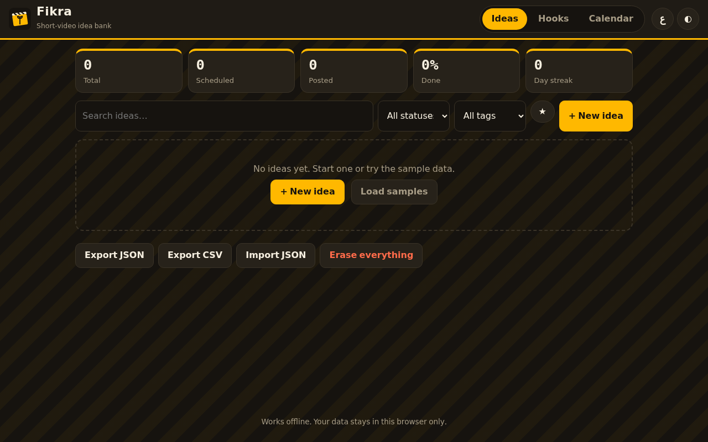
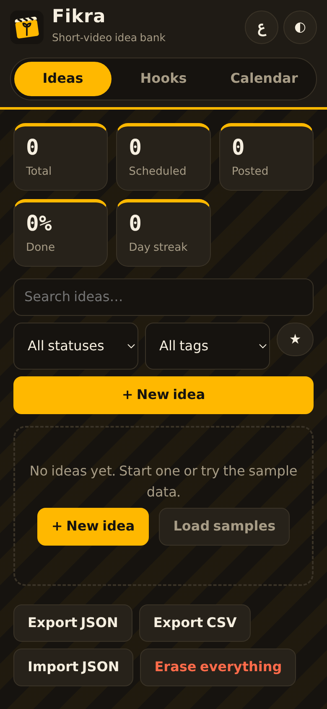
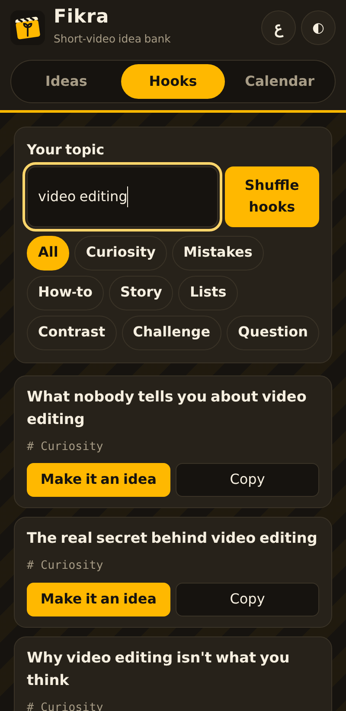
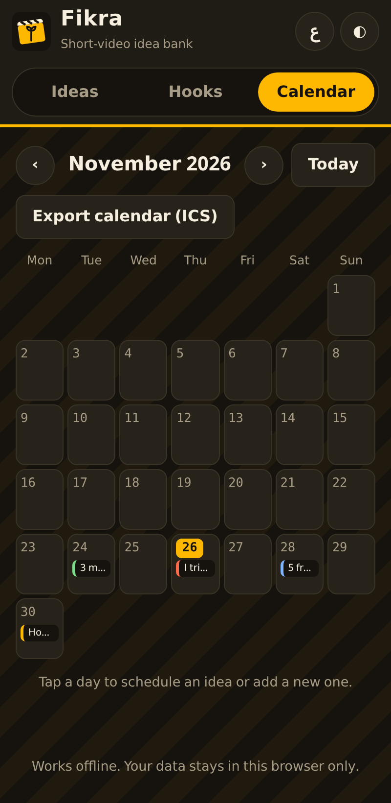
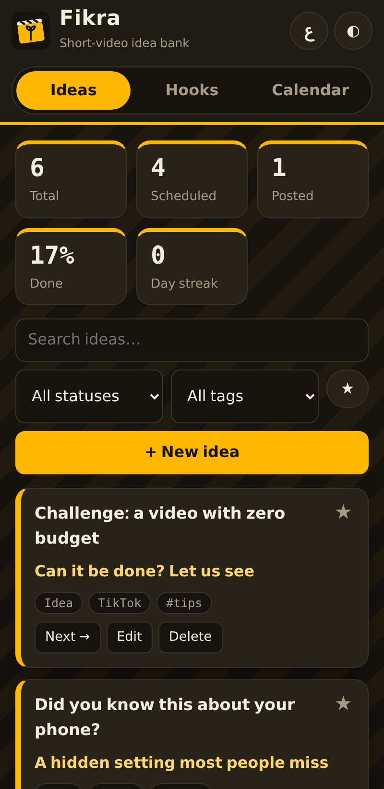

<p align="center"></p>

<h1 align="center">Fikra · فكرة</h1>

<p align="center"><b>An offline idea bank for Shorts, Reels and TikTok.</b><br>Keep every video idea, fill proven hook templates with your topic, and plan the week on a calendar.<br>Arabic (RTL) and English. No account, no server.</p>

<p align="center"><a href="https://yousefkhames.github.io/fikra/"><b>Open the live demo</b></a></p>

## Screenshots

Captured from the live site (https://yousefkhames.github.io/fikra/).

<p>
  
  
</p>

## Pitch

Most short-video ideas die in a notes app. Fikra gives them a pipeline (idea, script, filmed, posted), 24 hook templates in Arabic and English to get the first three seconds right, and a month calendar so each idea gets a date.

<p align="center">



</p>
<p align="center"></p>

## Features

- **Idea bank**: title, hook, tag, platform, status, date, notes, favorite star. Search and filter by status, tag or favorites.
- **Pipeline**: move an idea from idea to script to filmed to posted in one tap.
- **24 hook templates** in 8 categories (curiosity, mistakes, how-to, story, lists, contrast, challenge, question). Type your topic and every hook fills in. Shuffle, copy, or turn one into an idea.
- **Content calendar**: month view, add a new idea on a day, schedule an existing one, unschedule it.
- **Stats**: totals, scheduled, posted, completion percent, posting streak.
- **Export and import**: JSON, CSV (formula-safe), and ICS for your phone calendar. JSON import merges without duplicates.
- **Arabic and English** with full RTL layout, dark and light themes, mobile first.
- **Works offline** after the first load (service worker).

## Tech

Plain HTML, CSS and JavaScript. No framework, no build step, no dependencies at runtime. Data lives in `localStorage`. Page text is always set with `textContent`, so ideas cannot inject HTML.

```
index.html  style.css  app.js     UI
logic.js                          pure logic (dates, filters, templates, ICS, CSV, import)
sw.js  manifest.webmanifest       offline support
tests/logic.test.js               12 unit tests (node:test)
tests/e2e.js                      real-browser click-through (puppeteer-core + Chrome)
```

## Run and test

```
python3 -m http.server 8000        # then open http://localhost:8000
npm test                           # unit tests, no install needed
npm i puppeteer-core && node tests/e2e.js http://localhost:8000/
```

The end-to-end run covers adding, searching, editing, deleting, status changes, language and theme switching, hooks, the calendar, persistence, corrupted storage, import, wipe, offline mode, overflow at phone widths, and console errors.

## Honest limits

- Data is stored per browser and per device. Clearing site data erases it. There is no sync; use the JSON export to move or back up.
- GitHub Pages is a demo host. For daily use, install it as an app from your browser or host it yourself.
- Templates are fixed wording, not AI-generated, and the sample data is placeholder text.
- Calendar is month view only, with no reminders or notifications.
- The Arabic hook wording was written by hand and has not had a professional language review.

## License

MIT. See [LICENSE](LICENSE).
